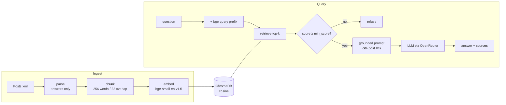

# cooking-rag

**A retrieval-augmented generation pipeline built from scratch, and an evaluation harness that decides what goes into it.**

Ask a long-tail cooking question; get an answer synthesized only from real
[Seasoned Advice (Cooking Stack Exchange)](https://cooking.stackexchange.com) answers, with every claim cited,
or a refusal when the corpus has nothing relevant. No LangChain, no LlamaIndex: chunking, embedding, BM25,
fusion, reranking, prompting and evaluation are each a small hand-written module behind an interface, so any
one of them can be swapped and measured.

The point of the project is the measuring. Every retrieval idea below was run through the same harness, and
**most of them lost**. The README records which, by how much, and why.

   

---

## Results at a glance

Held-out set of **500 questions** (seed 42), index of **64,239 answers → 73,181 chunks**.

| Retrieval config | Hit@1 | Hit@5 | Hit@10 | MRR | Verdict |
|---|---|---|---|---|---|
| **Dense (bge-small) + query-instruction prefix** | **0.25** | **0.51** | **0.59** | **0.36** | ✅ shipped |
| Dense, no prefix (baseline) | 0.23 | 0.48 | 0.55 | 0.34 | superseded |
| Hybrid dense + BM25 (RRF, k=60) | 0.21 | 0.45 | 0.54 | 0.31 | ❌ rejected |
| Hand-built BM25 alone | 0.15 | 0.29 | 0.37 | 0.22 | ❌ rejected |
| Dense + cross-encoder rerank (bge-reranker-base) | 0.19 | 0.42 | 0.52 | 0.29 | ❌ rejected |

Answer quality, judged by an **independent model family** (generator Claude Sonnet 4, judge GPT-4o, 1–5 scale, n=50):

| Retriever | Correctness | Faithfulness | Refusals |
|---|---|---|---|
| **Dense + prefix** | **4.00** | **4.48** | 0 |
| Dense + rerank | 3.46 | 4.25 | 2 |

**What the numbers say**

- **A one-line change beat every "upgrade."** Prepending bge's query-instruction prefix moved Hit@5 from 0.48 to 0.51.
- **Keyword search hurts on this corpus, at every weight.** A sweep of the BM25 fusion weight (0 → 0.25 → 0.5 → 1.0) degraded monotonically. Queries are short question titles, and answers rarely repeat their vocabulary.
- **The reranker lost twice, for two different reasons.** The diagnosis is in [What the harness caught](#what-the-harness-caught).

Full leaderboard, sweep tables and investigation notes: [`RESULTS.md`](RESULTS.md).

---

## How it works



**Why this corpus:** Stack Exchange accepted answers are free, self-labelling ground truth. For any question,
the answer its asker accepted is the retrieval target, so the harness can score thousands of queries with no
manual labelling. Only **answers** are indexed; **questions** are used as queries and eval probes.

### Modules

One responsibility each, behind small ABCs, so the harness can A/B implementations:

| Module | Responsibility |
|---|---|
| `ingest.py` | Two-pass parse of `Posts.xml` → `Document`s (HTML stripped, accepted answer flagged) |
| `chunk.py` | `FixedSizeChunker`, a sliding word window that preserves chunk order |
| `embed.py` | `SentenceTransformerEmbedder` (bge-small + query prefix) and a deterministic offline `FakeEmbedder` |
| `store.py` | `ChromaStore`, a cosine vector store with batched writes and paginated reads |
| `bm25.py` | BM25 from scratch: tokenizer, inverted index, IDF/length normalization |
| `retrieve.py` | `DenseRetriever`, `BM25Retriever`, `HybridRetriever` (weighted reciprocal-rank fusion) |
| `rerank.py` | `Reranker` ABC, cross-encoder implementation, `RerankingRetriever` (over-fetch, then rerank) |
| `generate.py` | Grounded prompt, citation extraction, refusal gate, `OpenRouterLLM` |
| `pipeline.py` | `RagPipeline.index()` / `.query()`, which enforces the answers-only rule |
| `eval/` | Test-set builder, Hit@k/MRR metrics, retrieval runner, LLM-judge answer-quality runner |
| `factory.py` | Composition root: the only place real components are wired together |
| `cli.py` | The `rag` command |

---

## The evaluation harness

Two metric families, because each one is blind where the other sees.

**1. Retrieval: Hit@k and MRR against the accepted answer.** These are deterministic and free, with no LLM
call. Retrieval over-fetches 50 chunks, then dedupes to distinct answers, so one long answer can't take
several slots. These scores are a lower bound: they credit only the accepted post, so a correct answer from a
different post counts as a miss.

**2. Answer quality: an LLM judge for correctness and faithfulness.** This covers what metric 1 undercounts.
Design choices:

- **Independent judge.** Generation and judging use different model families (`OPENROUTER_JUDGE_MODEL`), which avoids self-preference bias.
- **Scoped faithfulness.** Faithfulness is scored only against the chunks the answer was actually built from, not everything retrieved.
- **Reproducible runs.** Temperature is 0 and samples are seeded. Each run writes a per-case JSON artifact recording both model IDs.
- **Errors aren't scores.** Refusals and judge parse errors are counted separately, not scored as zeros.

### What the harness caught

The reranker is the instructive case. On Hit@k it looked bad, but inspection suggested the metric was unfair:
for *"Do some fish smell fishier? Why?"* it promoted arguably better answers above the accepted one. So the
LLM judge was built to settle it. The judge **did not vindicate the reranker**: per question it was better on
7, worse on 17 and tied on 24. Digging into the failures found two separate causes:

1. **A real model weakness.** For *"How can I handle black pepper without sneezing?"* the cross-encoder promoted chunks about chili and bell peppers: word-sense confusion. Correctness was 1 against dense's 5.
2. **A harness artifact.** The refusal gate (`min_score = 0.2`) was tuned on cosine similarity (0.7–0.83 here) but applied to cross-encoder scores, which sit on a different scale. It silently dropped relevant chunks in **21 of 50** rerank cases: 3.84 usable chunks against dense's 5.00.

Cause 2 inflates the gap, but cause 1 means the direction holds. The reranker stays out of `ask`, and a
retriever-aware threshold is the first item on the backlog. The machinery (`--retriever rerank`) is kept for
that re-measurement.

---

## Quickstart

**Requirements:** Python ≥ 3.11, [uv](https://docs.astral.sh/uv/), `7z` (`brew install p7zip`), and an
[OpenRouter](https://openrouter.ai) key. The key is only needed for `ask` and `eval-quality`; retrieval eval is
fully offline.

```bash
uv sync --extra dev                       # installs deps (incl. PyTorch) and the `rag` command
cp .env.example .env                      # set OPENROUTER_API_KEY; OPENROUTER_MODEL is optional

# corpus: the Cooking Stack Exchange data dump (CC BY-SA)
mkdir -p data
curl -L -o cooking.7z https://archive.org/download/stackexchange/cooking.stackexchange.com.7z
7z e cooking.7z Posts.xml -odata/

uv run rag index data/Posts.xml           # → Indexed 73181 chunks from 64239 answers (91564 posts parsed).
uv run rag ask "how do I keep guacamole from browning?"
```

An answer cites the post IDs it drew on (`https://cooking.stackexchange.com/a/<id>`) and is written only from
retrieved text. The prompt forbids the model's own memory and the web. If nothing scores above the
relevance gate, it refuses.

### Reproduce the evaluation

```bash
uv run rag eval-build data/Posts.xml --n 500      # held-out test set (seeded)
uv run rag eval-compare                           # dense vs bm25 vs hybrid, one table
uv run rag eval --retriever rerank                # score any single retriever
uv run rag eval-sweep --weights 0,0.25,0.5,1.0    # hybrid BM25-weight sweep
uv run rag eval-quality --retriever dense --n 50  # LLM-judged answer quality (needs API key)
```

### Command reference

| Command | Description |
|---|---|
| `rag index <Posts.xml>` | Parse, chunk, embed and persist the index to `.chroma/` |
| `rag ask "<question>" [-k N]` | Grounded, cited answer from the top-k passages |
| `rag eval-build <Posts.xml> [--n N] [--seed S] [--out PATH]` | Build the held-out test set |
| `rag eval [--retriever dense\|bm25\|hybrid\|rerank] [--fetch N]` | Hit@1/5/10 and MRR for one retriever |
| `rag eval-compare [--fetch N]` | All retrievers in one table |
| `rag eval-sweep [--weights W,...]` | Sweep the BM25 fusion weight of the hybrid retriever |
| `rag eval-quality [--retriever R] [--n N] [-k K] [--out PATH]` | Generate and LLM-judge answers; writes a JSON artifact |

**Configuration** (`.env`): `OPENROUTER_API_KEY` (required for generation), `OPENROUTER_MODEL` (default
`anthropic/claude-sonnet-4`), `OPENROUTER_JUDGE_MODEL` (defaults to the generation model; set it to a
different family for unbiased judging).

---

## Engineering notes

- **Test-driven, offline by default.** 88 tests run with a deterministic `FakeEmbedder`, `FakeLLM` and `FakeJudge` and an ephemeral Chroma store, so there's no network and no model download. 4 real-model tests are gated behind `-m slow`.
  ```bash
  uv run python -m pytest -m "not slow" -q
  uv run python -m pytest -m slow
  ```
- **One variable at a time.** A config is an embedder, a chunker and a retriever. Every experiment changes exactly one of them, on a feature branch, and is merged with its result recorded in `RESULTS.md`, including the negative ones.
- **Scale bugs found on the first real run.** Chroma rejects writes above 5,461 records per call, and the full index is 73,181 chunks, so writes are batched. Reading every chunk back to build the BM25 index hit SQLite's variable limit, so reads are paginated.

## Backlog

- Retriever-aware refusal/faithfulness threshold (normalize cross-encoder scores), then re-measure rerank
- Embedding model comparison (`text-embedding-3-small` / `-large`)
- Chunking sweep: window size and overlap, sentence and semantic chunking
- Query rewriting: expansion, HyDE, decomposition
- Setup 2: hold out each question's own accepted answer, to force synthesis across posts

## Data and license

Corpus: the [Stack Exchange data dump](https://archive.org/details/stackexchange) for cooking.stackexchange.com,
licensed [CC BY-SA 4.0](https://creativecommons.org/licenses/by-sa/4.0/) by its contributors. The dump is not
redistributed here; `data/` is gitignored. Cited answers link back to their original posts.
